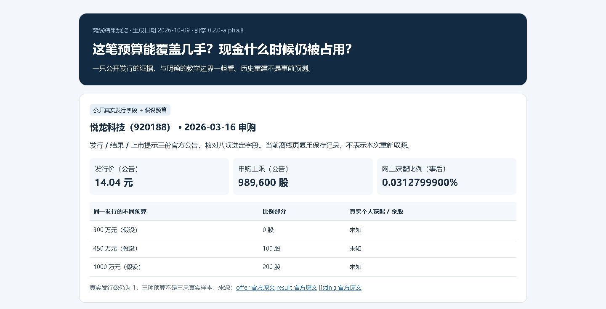

# 北交所新股获配与资金研究

比较申购预算下的比例获配情景、资金占用与现金冲突。

[](LICENSE) · [当前发行版 v0.2.0-alpha.16](https://github.com/KILING-TASI/bjx-ipo-engine/releases/tag/v0.2.0-alpha.16) · [运行检查](https://github.com/KILING-TASI/bjx-ipo-engine/actions)

## 能解决什么问题

**预算增加，为什么未必多获一百股？几只新股会不会占用同一笔钱？**

独立维护发行获配和现金情景；公告资料可自行准备，研究价值判断由研究者或工作台负责。

## 快速开始

从[发行页](https://github.com/KILING-TASI/bjx-ipo-engine/releases/tag/v0.2.0-alpha.16)下载完整源码并解压，需要 Python 3.10 或以上。在源码目录执行：

```text
python try_demo.py --no-open --out-dir reports/first-demo
```

按提示打开新生成的 HTML。Windows 也可双击 `Start-Demo.cmd`，Linux/macOS 可用 `sh Start-Demo.sh`。教学使用原创模拟资料，不自动取真实数据；重复运行使用新目录，历史结果保留。

[查看已保存的报告示例](docs/preview/index.html)。HTML请随完整源码下载后打开；示例按自身生成日期和口径阅读。



图片是历史示例，不能推定全部新报告已完成视觉验收。

## 使用自己的资料

先按[资料准备](BEGINNER.md)填写输入，再看[详细命令与方法](USAGE.md)。需要安装CLI时，在自己的Python环境运行：

```text
python -m pip install .
bjx-ipo-engine --help
```

仓库、Python发行包、安装命令及Skill注册名均为 `bjx-ipo-engine`。CLI安装和Skill注册是两个步骤：自然语言调用按[SKILL.md](SKILL.md)配置，保留完整资源；不必安装全部仓库。安装普通构建依赖可能联网，教学流程不需要作者缓存。

## 结果范围

当前计算口径版本为 `0.2.0-alpha.8`，与发行版本分别维护；旧结果按自身记录解释。

余股、真实获配和到账未知时保留未知；无明确概率不计算期望，不称确定最优申购。

报告中的来源、日期、假设和未知事项需一起阅读。程序运行成功不等于来源已经认证、资料完整或投资判断有效。原创代码采用MIT，第三方代码、公告、研报和数据仍按各自权利范围处理。

## 文档与维护

- [详细命令与方法](USAGE.md)
- [资料准备与排错](BEGINNER.md)
- [Skill调用指引](SKILL.md)
- [版本记录](CHANGELOG.md)
- [许可与第三方范围](THIRD_PARTY_NOTICES.md)
- [审计范围](AUDIT_SCOPE.md)

[贡献说明](CONTRIBUTING.md) · [安全反馈](SECURITY.md) · [更新与清理](LIFECYCLE.md) · [English](README.en.md)

[按问题选择其他工具](https://github.com/KILING-TASI/research-workbench/blob/main/references/tool-navigation.md)。共12个活跃仓，另有1个供旧记录复查的[历史契约仓](https://github.com/KILING-TASI/cn-research-contracts)。各仓分别发布；main的后续文档整理不改写旧发行包和冻结结果。
